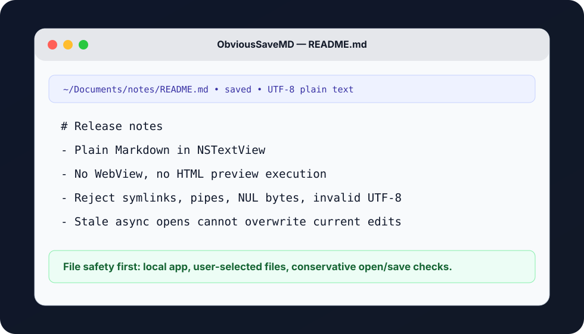

# ObviousSaveMD

[](https://github.com/DiscoStew6082/ObviousSaveMD/actions/workflows/ci.yml)

ObviousSaveMD is a small native macOS Markdown and text editor built with SwiftUI and AppKit. It keeps Markdown as plain text in an `NSTextView`; there is no HTML preview, web view, script execution, or remote media loading path.

## 30-second proof

- **Problem:** many Markdown editors turn simple text editing into a preview/rendering surface with extra file and web risk.
- **System:** native macOS editor shell using SwiftUI and AppKit, with plain-text Markdown editing in `NSTextView`.
- **Safety boundary:** opens are limited to Markdown/text document types and validated after selection; hostile file intake rejects symlinks, non-regular files, named pipes, oversized files, NUL bytes, and invalid UTF-8.
- **Correctness:** stale async open results are ignored when the current document changed or a newer open request happened.
- **Stack:** Swift 6.3, SwiftUI, AppKit, Swift Testing, GitHub Actions, native app bundle script.

**Recruiter signal:** this is a native desktop app proof artifact focused on local-first UX, file-safety boundaries, and tested AppKit edge cases rather than a web wrapper.



## Features

- Open and edit Markdown or plain-text files.
- Save existing files or save untitled drafts with Save As.
- Show the current file name, path, save state, and macOS document-edited indicator.
- Wrap long lines with a vertical scrollbar.
- Preserve UTF-8 text, including non-ASCII Markdown.
- Use one paste policy for the editor and clipboard fixtures. Rich and plain
  representations from the same item are alternatives; separate plain-text
  items are preserved even when their text resembles another item’s filename.

## File Safety

Opening a file is intentionally conservative:

- The open dialog is limited to Markdown and plain-text document types, with file-content validation after selection.
- Reads happen off the main actor so slow file I/O does not block the UI thread.
- The file reader rejects symlinks, non-regular files, named pipes, oversized files, NUL-containing data, and invalid UTF-8 before loading content into the editor.
- The default read limit is 20 MiB.
- If an open operation finishes after the current document changed or after a newer open request, the stale result is ignored.

Saving rejects symlink and non-regular existing destinations before writing. The current app bundle is not sandboxed, does not use security-scoped bookmarks, and relies on normal macOS file permissions and user-selected paths.

## Use

Build the app bundle, then open the printed `.app` path in Finder. Use Open, Save, and Save As from the toolbar or the standard keyboard shortcuts:

- Open: Command-O
- Save: Command-S
- Save As: Shift-Command-S

The editor prompts before replacing or closing a document with unsaved changes.

## Requirements

- macOS 14 or newer
- Xcode or Swift toolchain compatible with Swift 6.3

## Build

Run the test suite:

```sh
swift test
```

Build a Finder-launchable app bundle:

```sh
Scripts/build-app.sh
```

The script prints the generated absolute app path. The exact path varies by checkout and configuration, for example:

```text
/path/to/ObviousSaveMD/.build/<triple>/debug/ObviousSaveMD.app
```

To build a release bundle:

```sh
CONFIGURATION=release Scripts/build-app.sh
```

GitHub Actions runs `swift test` on push and pull request events via `.github/workflows/ci.yml`.

## Project Layout

- `Sources/ObviousSaveMD`: SwiftUI/AppKit app shell and editor view.
- `Sources/ObviousSaveMDCore`: document state and UTF-8 file I/O.
- `Tests`: Swift Testing coverage for document behavior, editor setup, and hostile file intake.
- `Resources/Info.plist`: app bundle metadata used by `Scripts/build-app.sh`.
- `.github/workflows/ci.yml`: GitHub Actions test workflow.
- `SECURITY.md`: current file-intake security notes and limitations.

## Status

This is an early local macOS editor. It edits Markdown as plain text and does not include Markdown preview rendering, document sandbox entitlements, autosave, or notarized distribution packaging yet.

## License

ObviousSaveMD is released under the [MIT License](LICENSE).
